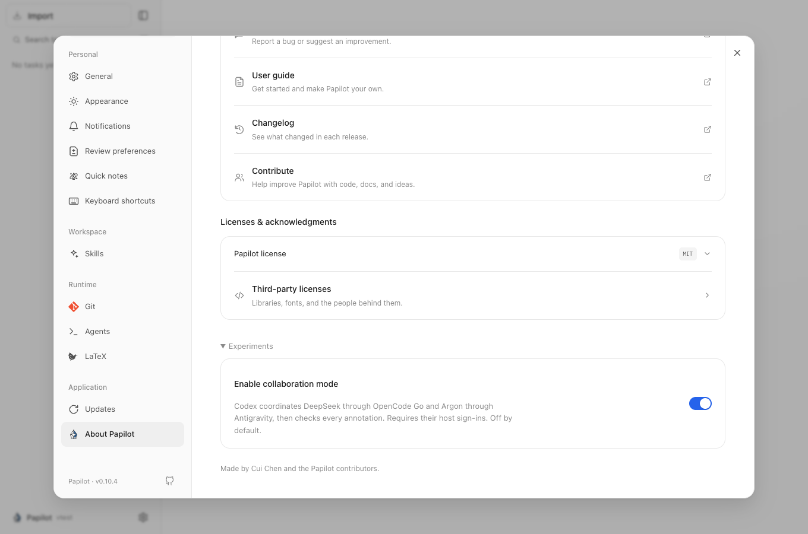

# Collaboration mode

An opt-in experiment for editing many PDF annotations with the existing Codex app-server. It is hidden by default. Open **Settings → About Papilot → Experiments**, then turn on **Enable collaboration mode**. It becomes available in the agent/model picker once Codex is detected. The setting is saved on the Papilot host and shared by its browsers. Turning it off hides new choices; existing tasks can continue.

Codex plans the work by annotation intent and source span. Simple edits go to DeepSeek through **OpenCode Go**; prose polishing goes to Gemini Argon through Antigravity. Codex keeps reasoning, factual checks, references, formatting and ambiguous changes. This mode edits annotations; use Codex directly for the AI review skill that generates new PDF notes.

[Mobile, dark theme](assets/collaboration-mobile-dark.png) · [Mobile, Simplified Chinese](assets/collaboration-mobile-zh-CN.png)

## Host setup

Sign in to Codex as usual. Install OpenCode on the machine running Papilot, open its TUI, and use `/connect` to select **OpenCode Go** and enter your Go key. Check `/models` for a DeepSeek model. This experiment defaults to `opencode-go/deepseek-v4.1-flash`. `PAPILOT_COLLABORATION_DEEPSEEK_MODEL` can select another available `opencode-go/deepseek-*` model; other providers are rejected. OpenCode owns the credentials. Papilot does not read or copy its key. Go account billing settings, including optional extra usage, still apply.

Install and sign in to `agy` for Argon. Papilot discovers an Argon model from the native catalog. `PAPILOT_COLLABORATION_ARGON_MODEL` can select another Argon catalog ID. `PAPILOT_OPENCODE_BIN` and `PAPILOT_AGY_BIN` override CLI paths. `PAPILOT_AGY_PROXY` applies the configured HTTP proxy only to Antigravity. Restart the Papilot host after changing environment variables.

See [OpenCode Go setup](https://opencode.ai/docs/console/go/) and [Antigravity CLI](https://antigravity.google/docs/cli/headless). No Pi installation is needed.

## Editing and final verification

Workers receive the selected annotations and source text in a fresh temporary directory. Their native permissions deny file, command and external-tool operations. They return proposals containing original and replacement text; they do not edit the task worktree. Codex is the sole editor and must check each original excerpt before integrating its proposal. Independent spans of the same file can therefore receive proposals concurrently without a file-wide lock. Overlapping proposals are reconciled by Codex.

Every note in the conversation up to the current turn has a stable message/index ID. The `workflow_audit` tool requires exactly one outcome per ID: addressed, unchanged with evidence, or blocked with an explanation. It verifies that quoted evidence exists, then opens a fresh Codex session to check the claims against the integrated sources and diff. Shared source files are included only once. Blocked notes remain unresolved and must be reported to the author.

A successful audit is saved with a fingerprint of tracked and untracked files plus all cited evidence, including ignored source files. Editing these files invalidates it. Both automatic publication and the manual comparison action require a current successful audit. A missing or failed audit holds the task for continuation. For layout changes, Codex is instructed to use the existing `view_pdf` tool before auditing; source-level coverage alone does not prove the PDF looks right. Papilot still compiles and publishes its normal review afterward.

Pausing, disconnecting or closing Papilot cancels outstanding helpers and discards late results. Helpers have a ten-minute request deadline. If an executor is missing, signed out or unavailable, the tool reports the error and Codex may handle that work itself after explaining the fallback. It never switches DeepSeek to a different provider. The audit is model-assisted review, not a proof of mathematical correctness.

## Development checks

`tests/collaboration.test.ts` and the collaboration cases in `tests/workspace.test.ts` use fake native runtimes and disposable Git repositories. They cover hidden selection, proposal isolation, provider restrictions, source evidence, cancellation, complete annotation accounting, failed/stale audits and publication. The UI check exercises enable/disable, persistence, errors and keyboard interaction on desktop and mobile layouts.

The settings disclosure follows Modern Web Guidance `accordion` and `html` using native `details`/`summary`; `checkbox` and `forms` preserve native input behavior, visible labels and error feedback.
